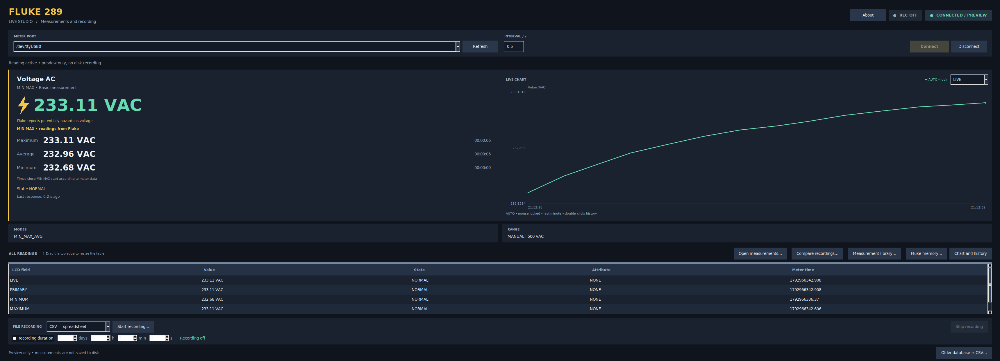
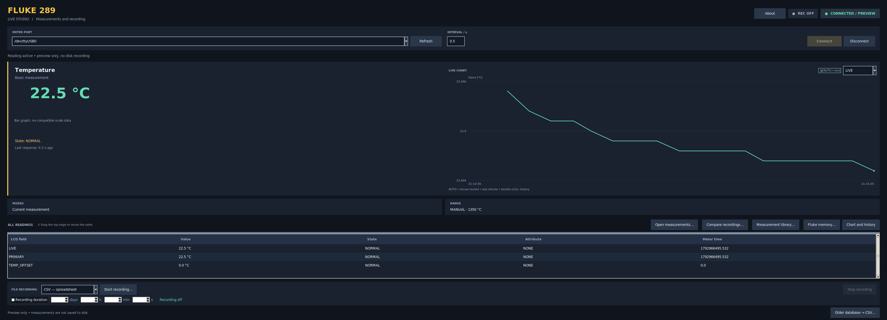
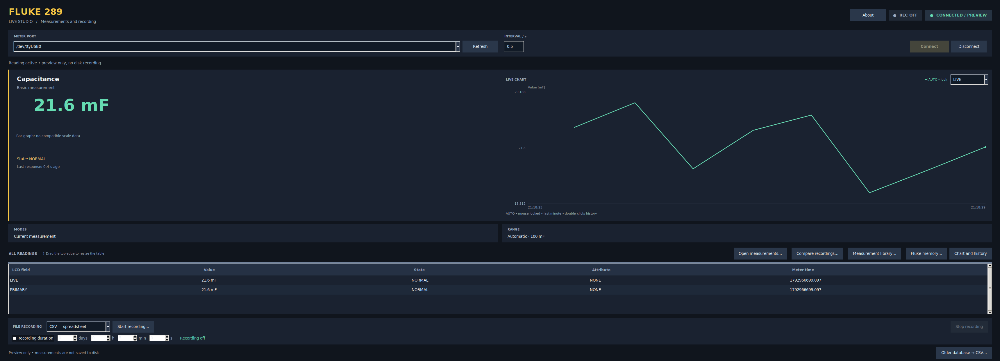

# Fluke 289 Live Studio 1.8.0 — EN version

**Interface language: English.** This release translates the application, messages, reports, documentation and test descriptions into English. Earlier Polish releases remain available.

Free software for a physical Fluke 289 on GNU/Linux: live readings, bar graph, meter MIN/MAX/AVG, interactive charts, A/B markers, timed CSV/SQLite recording, experimental meter memory download, a measurement library and recording comparison with PDF/CSV reports.

Independent project, not affiliated with Fluke or the GNU Project. Licensed under GNU GPL v3 or later (`GPL-3.0-or-later`); see [COPYING](COPYING). Provided WITHOUT WARRANTY.

Software Development, Design & Testing by Piotr. Developed with assistance from OpenAI Codex.

Project and issues: https://github.com/chudobapiotr5/fluke289-live-studio-en

## Debian/Ubuntu installation

Open `fluke289-live_1.8.0-1_all.deb` with your package installer, or run this in the download directory:

```bash
sudo apt install ./fluke289-live_1.8.0-1_all.deb
```

Launch **Fluke 289 Live Studio** from the application menu. Python >=3.12, Tk, pySerial and Cairo are system dependencies. Ubuntu 24.04 and newer are compatibility targets; full acceptance on Ubuntu 24.04 remains outstanding. Never run the application as root. A local DEB installer may show a generic icon and omit AppStream screenshots; including metadata inside the DEB does not guarantee a full software-store listing.

The package does not include a virtual environment, Windows drivers or user recordings. Updating replaces the application, not measurement files. The library uses the same local data directory. No automatic online updates are enabled merely by installing this DEB.

## Run from source

```bash
sudo apt update
sudo apt install python3-venv python3-tk libcairo2
python3 -m venv .venv
.venv/bin/python -m pip install .
bash ./run.sh
```

Connect a compatible optical serial adapter, turn on the meter, select its port and click **Connect**. Preview starts without disk recording. Enable file recording separately.

If the serial device requires membership in dialout:

```bash
sudo usermod -aG dialout "$USER"
```

Log out of the whole desktop session and back in afterwards. Do not use sudo to launch the GUI.

## Updating

Stop recording and close the application. Keep a backup of your measurements. Install the new DEB, or unpack new sources into a separate folder and repeat source installation without copying an old `.venv`. Earlier CSV/SQLite recordings and Fluke memory JSON backups remain readable. If recordings move, add their new folder to the library. Restarting directly from edited sources loads those changes; it does not refresh an installed DEB automatically.

## Documentation

- [User guide](docs/USER_GUIDE.md)
- [Protocol and limitations](docs/PROTOCOL.md)
- [Experimental memory download](docs/MEMORY.md)
- [File formats and privacy](docs/FORMATS.md)
- [Diagnostics and hardware acceptance](docs/DIAGNOSTICS.md)
- [Validation scope](docs/VALIDATION.md)
- [Development and packaging](docs/DEVELOPMENT.md)
- [Authors](AUTHORS.md), [third-party sources](THIRD_PARTY.md), [changelog](CHANGELOG.md)
- [Build test report](TESTS.txt)

The About window includes documentation, license and build information offline.

## Command-line tools

```bash
bash ./run.sh ports
bash ./run.sh diagnose /dev/ttyUSB0 --database diagnostics.sqlite3
bash ./run.sh export measurements.sqlite3 measurements.csv
bash ./run.sh --version
python3 -m unittest discover -s tests -v
```

Diagnose explicitly writes raw communication to the selected database. Ordinary GUI preview does not create measurement files until you start recording. Diagnostics may contain readings and the meter serial number. Release archives exclude private measurement sessions and virtual environments.

## Screenshots — English version

### Meter MIN MAX readings



### Temperature measurement



### Capacitance measurement


